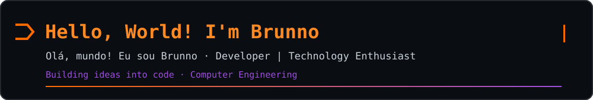
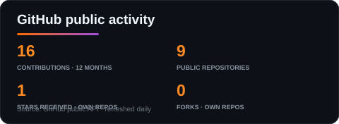
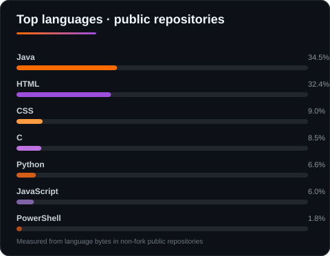
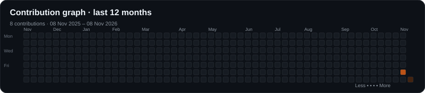

 

## `> whoami`

**EN** · I'm Brunno, a Computer Engineering student in my 6th semester (2024–2028 expected). I'm interested in internships in AI engineering, software development, or IT.

**PT-BR** · Sou Brunno, estudante de Engenharia da Computação no 6º período (2024–2028, previsão). Busco oportunidades de estágio em Engenharia de IA, desenvolvimento de software ou TI.

## `> education --coursework`

- **Computer Engineering / Engenharia da Computação** · UniAmérica Descomplica · 2024–2028 (expected / previsão) · 6th semester in progress / 6º período em andamento.
- **CS50x: Introduction to Computer Science** · Harvard University / edX · 2026. The course syllabus covers algorithms, data structures, C, Python, SQL, memory, and web fundamentals. [Official CS50x syllabus](https://cs50.harvard.edu/x/syllabus/).
- **Relevant coursework / Disciplinas relevantes** · Data Structures for Intelligent Systems; Database Application Development; Programming I; Software Engineering and Design; Cloud Computing Fundamentals; Computer Networks.

## `> projects --featured`

- **[DYSONOS — Self-Expanding Network](https://github.com/Brunno-fr/CS50X/tree/main/project)** · **CS50x final project**: a Flask and SQLite simulation that expands network capacity as demand grows. [Project README](https://github.com/Brunno-fr/CS50X/blob/main/project/README.md) · [Demo video](https://youtu.be/dox1g25N0tA).
- **[Tá Barato Demais](https://github.com/Brunno-fr/ta-barato-demais)** · Public web application for product offers and price comparison.
- **Task Management App / Aplicativo de Controle de Tarefas** · Academic Android project using Java, SQLite, and CRUD operations.
- **User Registration System / Sistema de Cadastro de Usuários** · Academic Python project using object-oriented programming.
- **UX/UI Prototype** · Navigation flow and interface prototype in Figma.

## `> foundations --currently_learning`

Studying the foundations covered in CS50x:

[-003B57?style=for-the-badge&logo=sqlite&logoColor=white)](https://www.sqlite.org/)

**Computer Engineering foundations · UniAmérica Descomplica**

Also studying foundations in data structures, database development, software engineering, cloud computing, and computer networks.

## `> soft_skills --show`

**EN** · Problem Solving · Analytical Thinking · Teamwork · Adaptability · Continuous Learning · Creativity · Communication

**PT-BR** · Resolução de problemas · Pensamento analítico · Trabalho em equipe · Adaptabilidade · Aprendizado contínuo · Criatividade · Comunicação

## `> github --stats`

  
  
  

## `> git log --visualize`

  <a href="https://github.com/Brunno-fr?tab=overview">
    <picture>
      <source media="(prefers-color-scheme: dark)" srcset="https://raw.githubusercontent.com/Brunno-fr/Brunno-fr/output/github-snake-dark.svg">
      <source media="(prefers-color-scheme: light)" srcset="https://raw.githubusercontent.com/Brunno-fr/Brunno-fr/output/github-snake.svg">
      
    </picture>
  </a>

## `> contact --open`

<!-- Profile cards and the terminal header are generated by .github/workflows/snake.yml. -->

